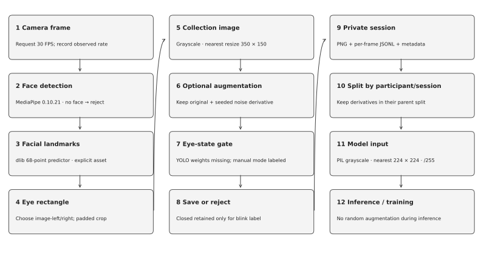
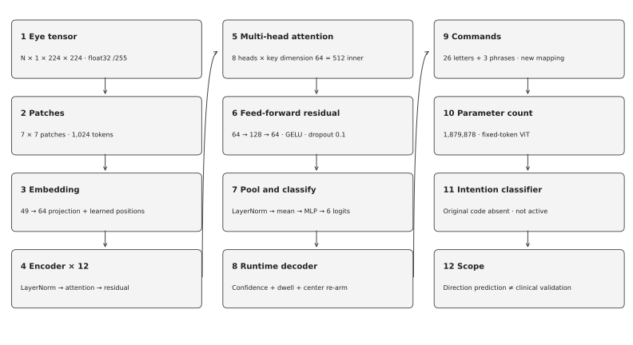
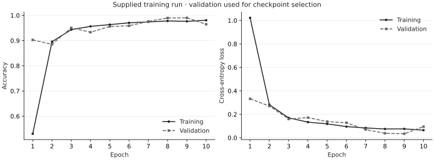
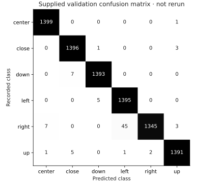

# CO-Sign Language

**Eye-direction commands for assistive communication.** CO-Sign explores how a webcam and a small vision model can turn sequences of eye directions into letters and common phrases for people with severe motor impairments, including ALS.

Project by **Yassin Khalaf and Sharl Effat**, Obour STEM School, Egypt. CO-Sign Language received a **Fourth Award in Systems Software at Regeneron ISEF 2025**, project **SOFT052T**. [Official award record](https://www.societyforscience.org/press-release/regeneron-isef-2025-full-awards/).

This repository combines the supplied training notebook and historical material with reconstructed collection and real-time scripts. It is a research prototype: the working software, supplied results and missing components are documented separately below.

## What you can run

- Replay 29 commands without a webcam, model weights or personal data: A–Z, “I'm hungry”, “I'm thirsty” and “I'm fine”.
- Load a compatible trained checkpoint, inspect predictions on a cropped eye image, or run webcam classification with a decoder.
- Collect eye crops using MediaPipe face detection and dlib landmarks, with a session manifest and explicit eye-state filtering mode.
- Inspect the model, reproduce numerical graphs, and run automated CPU tests or a bounded checkpoint benchmark.

The new command mapping uses exactly **three or four directional events** per command. Center dwell re-arms the decoder between events and is not part of the code. The mapping is reproducible, prefix-free and editable in [config/language.json](config/language.json); it is not claimed to be the original study's mapping.

## Quick start on Windows

Install a 64-bit [Python 3.10–3.12](https://www.python.org/downloads/windows/) if needed. The collection dependency pins use MediaPipe's legacy API and do not support arbitrary Python versions. No account, API key, Docker, WSL or global environment activation is required.

From the cloned repository:

```powershell
powershell -NoProfile -ExecutionPolicy Bypass -File .\scripts\setup.ps1 -Python 'C:\Path To Python\python.exe' -Backend cpu
powershell -NoProfile -ExecutionPolicy Bypass -File .\scripts\doctor.ps1
powershell -NoProfile -ExecutionPolicy Bypass -File .\scripts\test.ps1
powershell -NoProfile -ExecutionPolicy Bypass -File .\scripts\demo.ps1
```

`Bypass` applies only to that PowerShell process. Setup creates `.venv`, installs pinned direct dependencies and writes exact resolved packages to the private `local/resolved-requirements.txt`. Re-running setup uses the same environment. Use `-Backend cuda` to select the official PyTorch CUDA 13.0 wheel index; a suitable NVIDIA driver is still required. The script never updates drivers, installs compilers or reboots.

The demo prints all 26 letters and three phrases from **synthetic labeled events**. It verifies the decoder; it does not demonstrate recognition accuracy.

For Linux/macOS CPU tests:

```sh
python3.11 -m venv .venv
.venv/bin/python -m pip install torch==2.14.1 --index-url https://download.pytorch.org/whl/cpu
.venv/bin/python -m pip install -r requirements.txt
.venv/bin/python -m unittest discover -s tests -v
.venv/bin/python realtime_detection.py --events demos/events.jsonl
```

## The four main files

| File | Responsibility |
| --- | --- |
| [isef_preprocess.py](isef_preprocess.py) | Shared grayscale, resize and normalization contract; eye cropping; face/landmark locator; blink retention rule |
| [CO_Sign_PyTorch_GPU.ipynb](CO_Sign_PyTorch_GPU.ipynb) | Supplied GPU training notebook, with publication changes identified in its first cell |
| [realtime_detection.py](realtime_detection.py) | Checkpoint-compatible ViT, predictions, dwell/debounce decoder, event replay and webcam display |
| [data_collection_pipeline.py](data_collection_pipeline.py) | Bounded collection, optional noise augmentation, manual/YOLO gate, private images and manifests |

## Run your trained model

Model weights are **not bundled**. Supply a trusted checkpoint produced by the notebook; there is no random-model fallback or automatic download. The file must contain `model_state_dict`, `model_config`, ordered `class_names` and preprocessing metadata. Class order comes from the checkpoint, not from a guessed alphabetical index.

```powershell
# An already cropped eye: no face detector or camera needed.
.\.venv\Scripts\python.exe realtime_detection.py --checkpoint 'weights\comeback_best.pt' --image 'data\eye.png' --device cpu

# Install optional collection/display dependencies. dlib may need a manual compiler installation.
powershell -NoProfile -ExecutionPolicy Bypass -File .\scripts\setup.ps1 -Python 'C:\Path To Python\python.exe' -Backend cuda -Collection

# Use a licensed dlib landmark predictor; see docs/ASSETS.md.
powershell -NoProfile -ExecutionPolicy Bypass -File .\scripts\run.ps1 -Checkpoint 'weights\comeback_best.pt' -Predictor 'weights\shape_predictor_68_face_landmarks.dat' -Device cuda -Theme dark

# Alternative: manually specify the eye rectangle in camera pixels. Geometry is approximate.
powershell -NoProfile -ExecutionPolicy Bypass -File .\scripts\run.ps1 -Checkpoint 'weights\comeback_best.pt' -Roi '220,180,140,60' -Device cuda -Theme light
```

The window shows the camera, predicted class, confidence, pending directions and decoded text. Hold center for at least 150 ms, then a direction for at least 350 ms; return to center between every direction. Low-confidence/missing frames interrupt a dwell. Camera stalls cannot count as a held gaze. Incomplete commands expire after five seconds. `Space` inserts a space; `Backspace` deletes; `C` clears; `Q`/`Esc` exits. Sessions are bounded to five minutes by default (`--seconds` changes this).

No face or eye images are saved during live detection. Predictions may be wrong: a six-class classifier is not a calibrated gaze tracker, and its `close` class is not a timed blink detector. **The original intention filter is not active in this reconstruction.**

## Data collection and preprocessing



The collector requests 30 camera frames/second, detects a face, fits 68 dlib landmarks and extracts one padded eye rectangle. It converts the crop to grayscale and resizes it to **350×150**, optionally creates a seeded Gaussian-noise derivative, then applies the selected eye-state gate. Closed-eye samples are retained only for the explicit `blink` collection label. Unknown eye state is rejected.

**No trained YOLO eye-state checkpoint was supplied.** YOLO mode fails before opening a camera if weights are missing. Generic object-detection weights cannot replace a trained open/closed-eye model. Manual mode records the user's declaration and does not claim to detect eye state:

```powershell
.\.venv\Scripts\python.exe data_collection_pipeline.py --predictor 'weights\shape_predictor_68_face_landmarks.dat' --label up --gate manual --manual-state open --max-frames 150 --consent

# Later, after training or recovering an eye-state checkpoint with open/closed classes:
.\.venv\Scripts\python.exe data_collection_pipeline.py --predictor 'weights\shape_predictor_68_face_landmarks.dat' --label up --gate yolo --eye-weights 'weights\eye_state.pt' --max-frames 150 --consent
```

Outputs go into a new UUID session under `data/collected`: PNG eye crops, per-frame decisions and metadata. No full-face frames are saved. Metadata records requested/reported/processed FPS, retained/rejected counts, failure/cancellation state, seed, package versions and asset hashes. Images remain private and Git-ignored. Stop with `Q`, `Esc`, window close or Ctrl+C.

The notebook's model input is **224×224 grayscale, nearest-neighbor resize, float32, rescaled by 1/255**, NCHW in PyTorch. Live inference uses that same deterministic pixel conversion. Augmentation belongs in collection/training, never ordinary inference.

There is an unresolved historical crop discrepancy: the supplied original preprocessing script masks an entire frame and resizes it to **100×50**; the author described a **350×150 eye crop**, while the Canva board text says **300×150**; the notebook reads existing eye images and resizes them to **224×224**. The newly written collector and live locator share their geometry, but the geometry of the supplied checkpoint's training images is not established. The original script is preserved as a [source artifact](docs/evidence/original_preprocess.py.txt).

For new training, split participants/sessions **before augmentation** and keep every derivative with its parent. Prepare `data/train` and `data/validation`, each with the six folders `center`, `close`, `down`, `left`, `right`, `up`. The collection label `blink` must be explicitly reviewed before assigning it to the classifier's `close` folder: a single closed-eye image does not establish a blink event. Use a separate, untouched participant-level test set for any final accuracy claim.

Install `-Training` extras and open the notebook in a compatible kernel. `COSIGN_TRAIN`, `COSIGN_VALIDATION` and `COSIGN_RESULTS` override its relative paths. The notebook requires CUDA. Its former left/right-changing horizontal flip is disabled for future training; the supplied historical run used the earlier augmentation settings.

## Model and recorded results



The supplied implementation is a **fixed-token Vision Transformer**, with 1,024 patches, 12 encoder blocks, eight attention heads and **1,879,878 parameters**. Each head has key dimension 64, giving attention inner width 512. The code does not implement adaptive token halting; the historical “A-ViT” label should not be read as a description of an implemented adaptive mechanism.





| Evidence | Recorded value | What it establishes |
| --- | --- | --- |
| Supplied training history | Best validation accuracy **99.04%**, epoch 9 | Recorded validation result; checkpoint selection used this split |
| Supplied confusion matrix | **8,400** samples, **99.04%** accuracy | Agreement with the supplied best-epoch summary; data were not rerun here |
| New checkpoint verification | CPU/CUDA maximum probability difference **1.79×10⁻⁷** | Agreement on one deterministic generated input, not dataset accuracy |
| New bounded GPU measurement | See [RESULTS.md](docs/RESULTS.md) and raw samples | Model/input-processing timing on the documented laptop; excludes camera and detection |

The training artifacts were supplied from a directory named `run_20261003_200537_729963`. They are **not asserted to be the 2025 ISEF experiment**. Graphs above were rendered with Matplotlib directly from the provided history and confusion counts; curves or samples were not invented. [Numerical artifacts and source hashes](docs/evidence/).

The [historical Canva graph gallery](docs/HISTORICAL_GRAPHS.md) includes the original training curves, ViT/CNN matrices, text-entry chart, radar chart, attention heatmap and Kalman/NIS plots. These are preserved separately from the later notebook artifacts shown above.

The authors separately report **98% eye-direction accuracy**, **22 words/minute**, **32 participants including two people with ALS**, and **350,000+ self-collected eye images** for the original project. Participant records, full dataset and text-entry logs are not included, so this repository does not independently reproduce those historical claims. The poster's comparison chart shows 20 words/minute, while the author identifies 22 as the reported result; this discrepancy is retained in [the evidence notes](docs/HISTORICAL_EVIDENCE.md).

## Uses and limits

Students and assistive-technology researchers can examine the complete path from eye crops to classification to a small command language. Developers can replace the codebook, study false activations, test preprocessing consistency, or collect a properly consented dataset. Educators can demonstrate why high per-image validation accuracy does not automatically imply reliable text entry.

This release does not provide a validated medical communication aid or demonstrate equivalence with every part of the original system. It needs user-specific evaluation, an untouched test set, trained eye-state weights and recovered/validated intention logic before broader performance claims. Do not rely on this prototype as someone's only communication channel.

- [Walkthrough and demo script](docs/WALKTHROUGH.md)
- [All historical Canva graphs](docs/HISTORICAL_GRAPHS.md)
- [Historical figures, comparisons and ISEF award](docs/HISTORICAL_EVIDENCE.md)
- [Kalman/NIS method and missing implementation](docs/INTENTION_METHOD.md)
- [Assets, licenses and installation details](docs/ASSETS.md)
- [Measured results and reproduction](docs/RESULTS.md)
- [Learning notes and implementation boundaries](docs/LEARNING.md)
- [Video demo folder](demos/README.md)

## Contributing

Run the CPU tests before proposing a change. Keep trained weights, datasets, credentials and participant recordings out of Git. Include the checkpoint hash, preprocessing profile and evaluation split when reporting a model result. Report crashes through GitHub issues without attaching private images or tokens. See [CONTRIBUTING.md](CONTRIBUTING.md) and [THIRD_PARTY_NOTICES.md](THIRD_PARTY_NOTICES.md).
