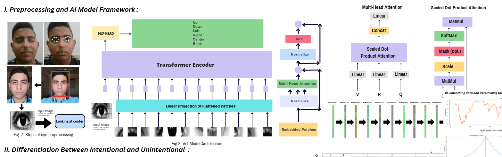
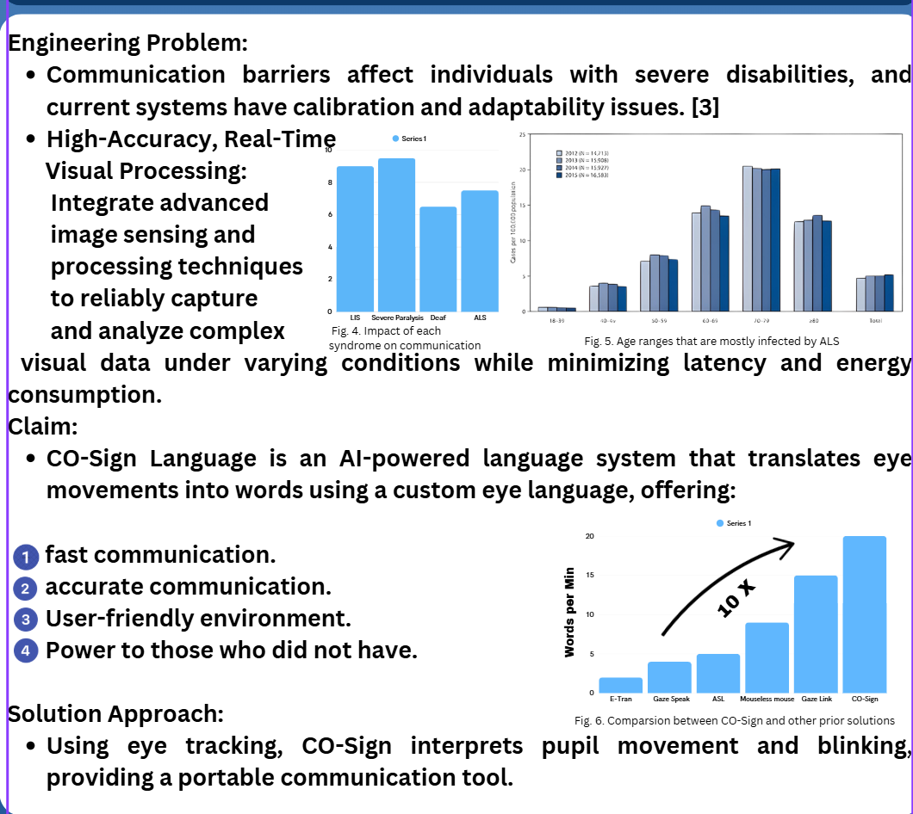

# Project record and figure provenance

## ISEF recognition

The Society for Science lists **SOFT052T — CO-Sign Language**, by **Sharl Effat and Yassin Khalaf**, Obour STEM School, Kalubya, Egypt, under **Fourth Award of $600**, **Systems Software, sponsored by Microsoft**, at Regeneron ISEF 2025. [Official full awards list](https://www.societyforscience.org/press-release/regeneron-isef-2025-full-awards/).

This is an award citation, not a recreated certificate. The official abstract/full project case was not retrieved; the repository description uses the authors' supplied material and does not claim to quote the official abstract.

## Reported original-study results

| Author-reported result | Available supporting material | Reproduction status |
| --- | --- | --- |
| 98% eye-direction accuracy | Author's project description | Original study logs/split unavailable |
| 22 words/minute | Author's stated historical figure | Text-entry timing logs unavailable; poster graphic shows 20 |
| 32 participants, including two with ALS | Author's description | Participant records not published here |
| 350,000+ self-collected eye images | Author's description | Full dataset and publication link not supplied |

These figures refer to the described original project, not the later supplied notebook run or the new synthetic inference check. They are not presented as measurements reproduced by this release.

The author supplied these comparative text-entry ratios:

| Comparison system | Reported CO-Sign ratio |
| --- | --- |
| GazeLink | 1.3× faster |
| Mouseless Mouse | 2.2× faster |
| E-tran | 10× faster |
| Sign language | 4× faster |
| GazeSpeak | 4.8× faster |

The source measurements, matching participant protocols and publication citations for these ratios were not provided. The ratios are historical claims, not a controlled head-to-head benchmark of this release. No missing comparator throughput is inferred by division. The poster's 20-word/minute chart and the author's 22-word/minute figure differ; both are retained with their provenance. Reconcile them against original timing logs before using a single comparison table in a paper or application.

## Supplied figures

[Open the historical graph gallery](HISTORICAL_GRAPHS.md). Eleven individual uploaded graph assets were subsequently recovered from the shared Canva design. Each original is retained with a hash; Matplotlib generates readable white-background previews without recreating data.

The board's historical results table reports accuracy 98.8%, loss 0.0398, precision 98.81%, recall 98.76%, F1 score 98.78%, and processing time 0.2105 (unit unspecified). These are poster-reported values, not results newly measured by this repository. The board also describes 300×150 eye crops, which differs from the author-described 350×150 stage and supplied 100×50 script.

Four screenshots were supplied by the author, who confirmed that the visible people are the project team and approved publication. They are preserved without editing; captions and claims remain those of the original poster. Embedded charts cannot establish participant-level validation without underlying data.

The [intention and smoothing excerpts](INTENTION_METHOD.md) document the reported Kalman/NIS approach. The supplied executable model is a fixed-token ViT; no adaptive token selection/halting is implemented.

## Poster board

[Author's Canva board link](https://canva.link/p8hqicedmjv0bf8). The board now opens through the background browser and its individual uploaded graph images have been recovered. A full-board PDF export prompts for Canva login and was not obtained. The original excerpts and [individual graph gallery](HISTORICAL_GRAPHS.md) are included; no complete board PDF has been fabricated.

## Reproducible numerical figures

`evidence/history.json` and `evidence/confusion_matrix.json` contain supplied numerical training outputs from the directory named `run_20261003_200537_729963`. The confusion counts total 8,400 and yield 99.0357% validation accuracy, matching epoch 9 in the history. The underlying dataset was not reevaluated during publication. Original source hashes are recorded in `evidence/source_hashes.json`.

The SVG/PNG training and confusion plots are generated by `scripts/make_figures.py`. Architecture/collection diagrams document this repository's code and reconstructed geometry. They are not photographs of the original experimental implementation.
