# Historical graphs from the Canva board

These are original figure assets recovered from the [author-shared Canva design](https://canva.link/p8hqicedmjv0bf8). They describe the historical poster, not newly reproduced experiments. Original files are preserved byte-for-byte; readable previews put transparent pixels over white using Matplotlib. [Source manifest and hashes](figures/canva/manifest.json).

The supplied notebook training artifacts and new GPU measurements are documented separately in [RESULTS.md](RESULTS.md). Raw numerical data and protocols for these poster graphs were not supplied, so no values were digitized or recreated.

## Historical model loss and accuracy

Figures 18–19. Combined source image; raw epoch samples were not supplied.

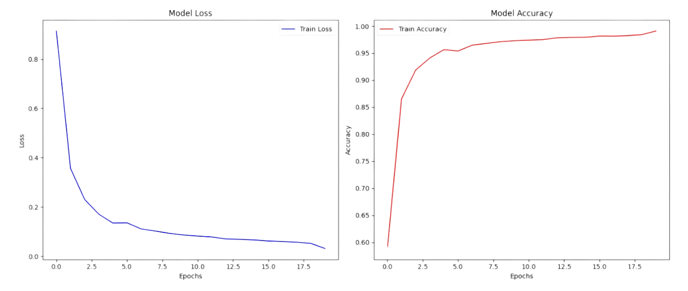

[Original image](figures/canva/originals/training-curves.png).

## Historical ViT confusion matrix

Figure 23. Class order is retained from the image, not inferred from the current checkpoint.

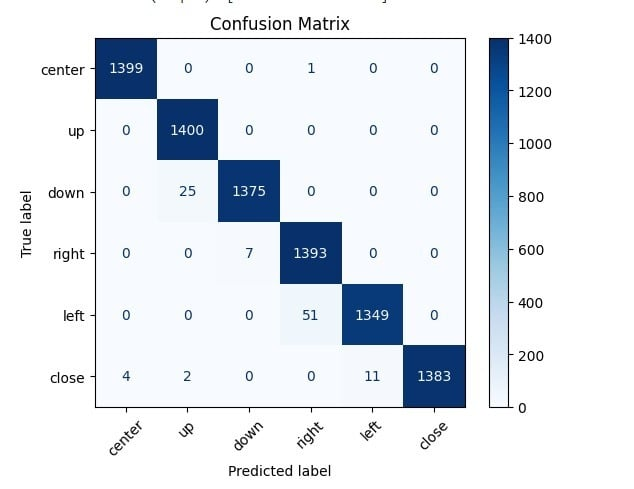

[Original image](figures/canva/originals/vit-confusion.jpg).

## Historical CNN confusion matrix

Figure 24. Comparator code, weights and evaluation protocol were not supplied.

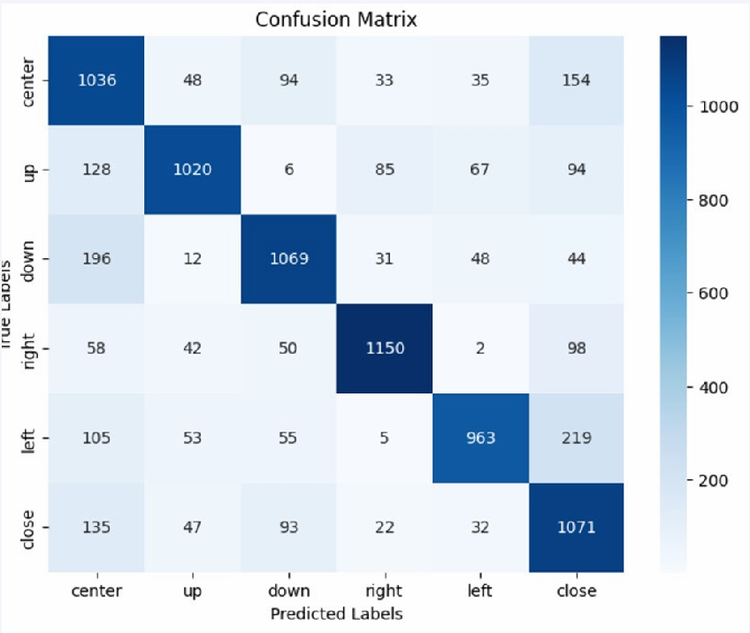

[Original image](figures/canva/originals/cnn-confusion.png).

## Text entry and comfort

Figure 20. Before/after chart annotates 16 WPM and 8/10 comfort after; its protocol is not supplied.

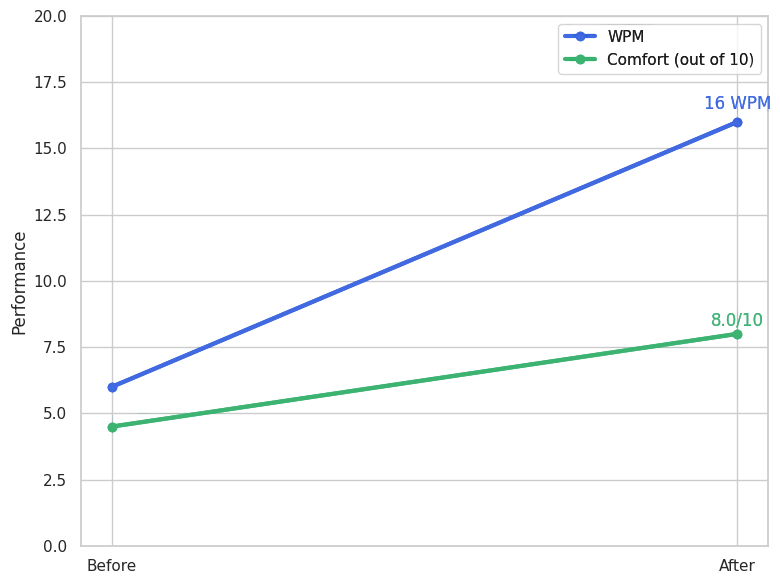

[Original image](figures/canva/originals/text-entry.png).

## Per-class radar chart

Figure 22. Metric scales and values are retained as drawn; they are not recalculated.

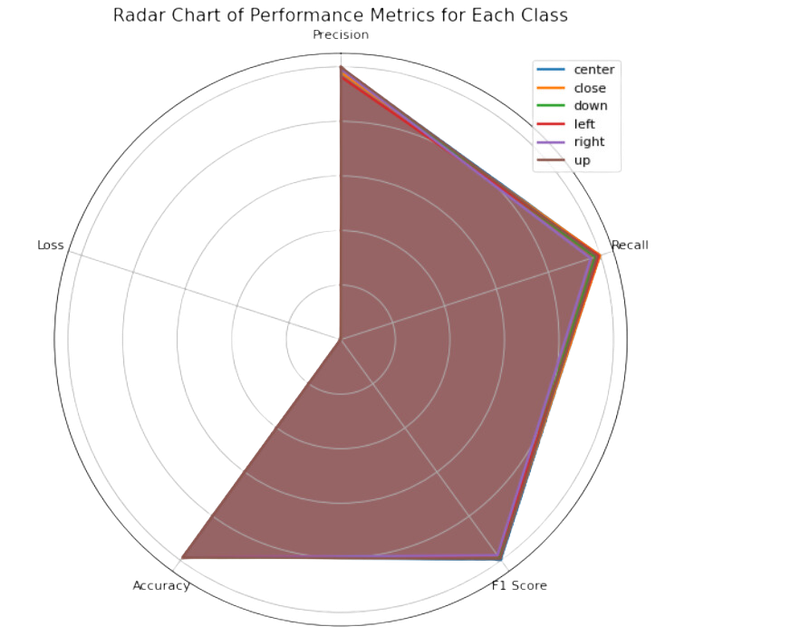

[Original image](figures/canva/originals/class-radar.png).

## Attention heatmap

Figure 26. Source inputs, layer selection and extraction code are not available.

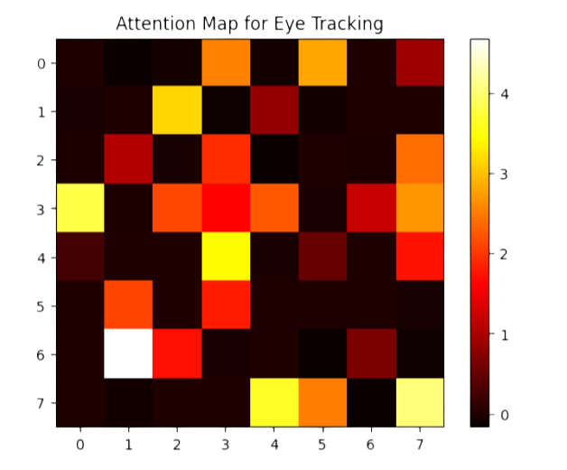

[Original image](figures/canva/originals/attention-map.png).

## NIS score over time

Figure 21. Original threshold and trace retained; raw timestamps/samples are not supplied.

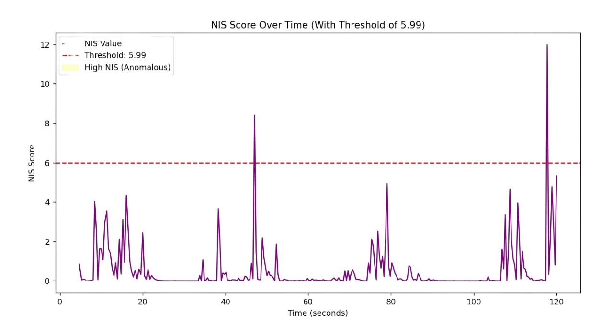

[Original image](figures/canva/originals/nis-over-time.png).

## Before and after Kalman filtering

Figures 13–14. Original comparison image; illustration versus recorded-data provenance is not established.

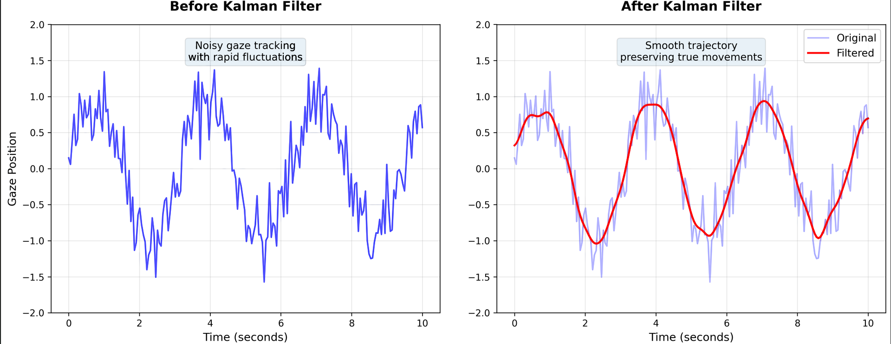

[Original image](figures/canva/originals/kalman-before-after.png).

## Raw and smoothed confidence

Figure 12. Original source plot; this filter is not active in the reconstructed runtime.

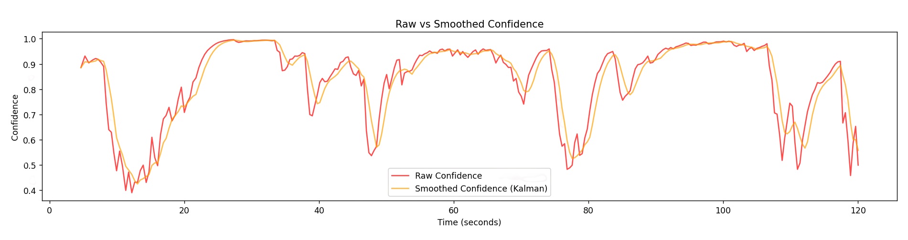

[Original image](figures/canva/originals/confidence-smoothing.png).

## NIS distribution by intent

Figure 11. Original labels retained; the 5.99 threshold does not by itself validate intent classification.

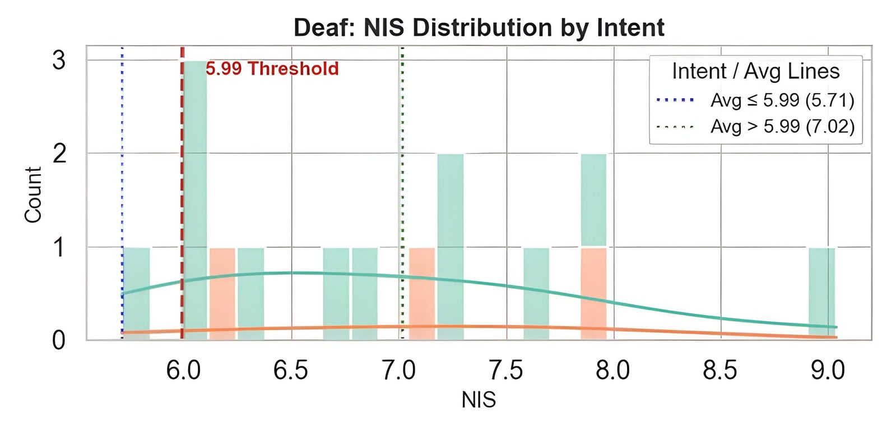

[Original image](figures/canva/originals/nis-distribution.jpg).

## ALS prevalence by age

Figure 5. Historical contextual figure attributed in the image to the National ALS Registry, United States, 2012–2015; not a new medical analysis.

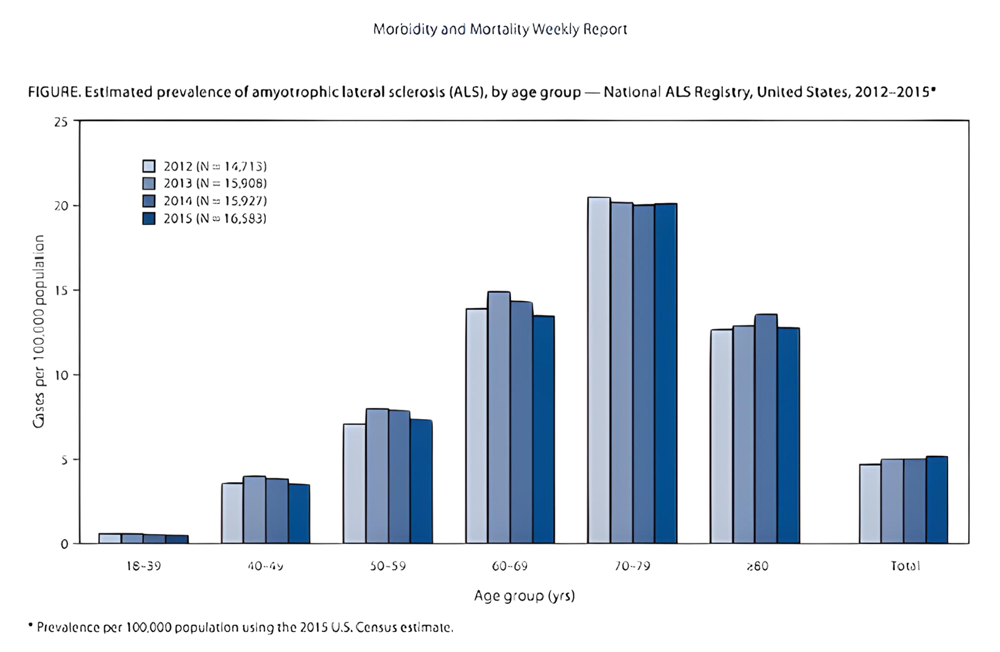

[Original image](figures/canva/originals/als-age-prevalence.png).

## Remaining poster charts

The existing [comparison excerpt](figures/comparison-poster.png) includes the original text-entry comparison bar chart and communication-context charts. The existing [smoothing excerpt](figures/smoothing-poster.png) includes the chi-square and p-value plots (Figures 15–16) and the other NIS histogram (Figure 17). These remain original poster images; separate numerical samples are unavailable.


## Reading the evidence

The text-entry chart annotates 16 WPM after testing; the poster comparison chart shows 20 WPM; the author reports 22 WPM. The protocols needed to reconcile those values were not supplied. All original views are retained. Historical CNN/ViT matrices are separate from the later notebook validation matrix. Attention extraction code and participant-level records are not included.

The threshold plots retain the poster’s wording. See [INTENTION_METHOD.md](INTENTION_METHOD.md) for why a chi-square consistency threshold does not establish intent-classification accuracy. The radar chart mixes metrics with different scales and should not be read as a single aggregate score.

## Regenerate the previews

```text
python scripts/prepare_historical_figures.py
```

This requires Matplotlib and Pillow, verifies the original file hashes and renders the same image dimensions on white. It does not train a model, alter axes or generate experimental data.
