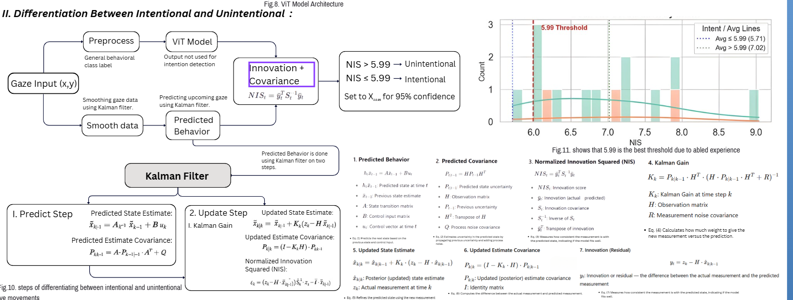
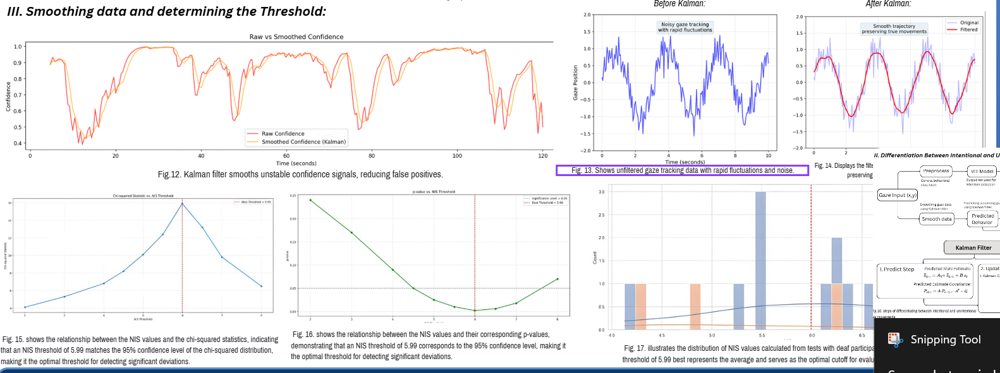

# Historical Kalman / NIS method

The supplied poster describes smoothing gaze coordinates and comparing a new observation with a Kalman prediction. The authors report using this method to distinguish intentional commands from involuntary movement. **The original implementation, calibrated gaze stream and labeled intention evaluation have not been recovered. No intention filter runs in the published real-time script.** The confidence/dwell rules in the decoder are newly implemented debounce logic, not a replacement for that experiment.

For a state estimate `x`, transition `A`, observation matrix `H`, process covariance `Q`, measurement covariance `R`, and observation `z`, the standard equations are:

```text
x_pred = A x
P_pred = A P A^T + Q
y      = z - H x_pred
S      = H P_pred H^T + R
NIS    = y^T solve(S, y)
K      = P_pred H^T S^-1
x_new  = x_pred + K y
P_new  = (I-KH) P_pred (I-KH)^T + K R K^T
```

The last line uses the Joseph covariance update. Solving a linear system is preferable to explicitly forming an inverse when evaluating NIS.

For two observation dimensions and a correctly specified linear Gaussian model, the upper 95th percentile of chi-square with two degrees of freedom is approximately **5.99**. It describes innovation consistency under those assumptions. It does **not** imply 95% intention-classification accuracy, an empirically optimal threshold, or that every large residual is involuntary. Intentional rapid movements can also produce large innovations.

The poster labels `NIS > 5.99` as unintentional and lower values as intentional. That rule is a historical proposal/report, not a validated decision rule supplied with this repository. The displayed p-value and smoothing graphics have no underlying sample files here; they are preserved as poster excerpts rather than redrawn as new experiments.

Before connecting this method to the real-time decoder, recover or specify:

1. How calibrated gaze `(x,y)` is obtained. The current model returns six class scores, not gaze coordinates.
2. State definition, sampling interval, `A`, `H`, `Q`, `R`, initial covariance and reset behavior.
3. How an accepted/rejected gaze observation becomes a directional command.
4. A participant-separated, labeled intention dataset, with false activations and missed intentional commands reported.

Do not substitute class probabilities for physical gaze coordinates without defining and evaluating a new model.



